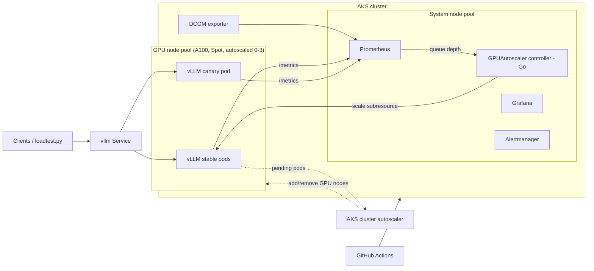

# GPU-Aware LLM Inference Platform on Kubernetes and Azure

Serve an open LLM (Llama 3 8B by default) on NVIDIA GPUs in Azure Kubernetes Service, with a custom Go controller that sizes the GPU fleet from live inference queue depth, canary releases gated on Prometheus metrics, and GitHub Actions CI/CD.



## What each piece does

| Path | Purpose |
|---|---|
| `infra/terraform/` | AKS (Azure CNI overlay + Cilium), tainted Spot A100 node pool autoscaling 0 to 3, ACR, Log Analytics (Azure Monitor) |
| `controller/` | Go controller and `GPUAutoscaler` CRD. Reads `vllm:num_requests_waiting + running` from Prometheus and resizes the vLLM Deployment. Scale-up jumps to demand; scale-down steps one replica at a time after a cooldown, because a GPU replica takes minutes to load weights |
| `charts/vllm-inference/` | Helm chart: stable and canary Deployments, shared Azure Files model cache, GPU tolerations and anti-affinity, PDB, ServiceMonitor, GPUAutoscaler resource |
| `monitoring/` | kube-prometheus-stack values, recording rules and alerts (TTFT, queue backlog, KV cache, canary errors, XID faults), Grafana dashboard |
| `loadtest/` | Async streaming load test reporting TTFT p50/p95/p99 and token throughput, plus a mock server for running it without a GPU |
| `scripts/` | Bootstrap, controller deploy, smoke test, canary deploy/analyze/promote/rollback, pause/destroy |
| `.github/workflows/` | CI (Go tests with race detector, helm lint + kubeconform, terraform validate, ruff, shellcheck) and CD (ACR build, controller rollout, automated canary) |

## Prerequisites

- Azure subscription with GPU quota. Check with `az vm list-usage -l eastus -o table | grep -i A100`. Request "Standard NCADS_A100_v4 Family" (Spot or regular) if it shows 0.
- Hugging Face account that has accepted the Meta Llama 3 license, and a read token.
- Local tools: `az`, `terraform >= 1.6`, `kubectl`, `helm >= 3.14`, `go >= 1.23`, `python >= 3.11`, `nc`.

Budget note: one Spot A100 is roughly $1-1.50/hour in most US regions and on-demand is several times that. Run `make pause` when you stop working; the GPU pool drains to zero nodes and you only pay for the two small system nodes. The A10 profile (`values-a10.yaml`, AWQ 4-bit model) is cheaper still.

## Quick start

```bash
# 1. Infrastructure (~10 min)
cp infra/terraform/terraform.tfvars.example infra/terraform/terraform.tfvars   # set subscription_id
make tf-init tf-plan tf-apply

# 2. Controller image (resolves go.sum on first build)
make controller-image TAG=v0.1.0

# 3. Cluster add-ons, controller, and vLLM (~15 min for the first GPU node + weights)
export HF_TOKEN=hf_xxx
CONTROLLER_TAG=v0.1.0 make bootstrap

# 4. Verify
make smoke
kubectl -n llm get gpuautoscalers
```

Use the A10 budget profile instead:

```bash
# terraform.tfvars: gpu_vm_size = "Standard_NV36ads_A10_v5"
VALUES_FILE=charts/vllm-inference/values-a10.yaml make bootstrap
```

## Try it

```bash
make port-forward     # terminal 1
curl -s localhost:8000/v1/chat/completions -H 'Content-Type: application/json' \
  -d '{"model":"llama-3-8b","messages":[{"role":"user","content":"What is paged attention?"}],"max_tokens":128}'

make grafana          # terminal 2, open http://localhost:3000, dashboard "LLM Inference - vLLM on AKS"
make loadtest-ramp    # terminal 3, watch replicas and GPU nodes follow the load
```

## How the autoscaler decides

Every 15 seconds, for each `GPUAutoscaler`:

1. `load = waiting + running` requests on the stable track (from Prometheus).
2. `demand = ceil(load / targetLoadPerReplica)`, clamped to `[minReplicas, maxReplicas]`.
3. If demand is higher: scale straight to it, unless a scale-up happened in the last `scaleUpCooldownSeconds`.
4. If demand is lower: remove one replica, only if nothing changed for `scaleDownCooldownSeconds`.
5. Status (load, current, desired, reason) is written back to the resource and exported as `gpuautoscaler_*` metrics.

When replicas drop, GPU nodes become empty and the AKS cluster autoscaler removes them after 5 minutes (`auto_scaler_profile` in Terraform). That is where the GPU-hour savings come from.

Why not a plain HPA? HPA on CPU or memory is meaningless for a GPU-bound server, and HPA scales down as fast as it scales up, which thrashes replicas that need minutes to load weights. Queue depth is the signal that tracks user-visible latency, and asymmetric cooldowns fit GPU startup cost.

Unit tests cover the decision logic and the Prometheus client:

```bash
make controller-test
```

## Releasing a new vLLM version

```bash
make canary NEW_TAG=v0.9.0
```

This starts one canary pod beside stable (the Service splits traffic by pod count), runs a smoke test against the canary only, soaks it for 10 minutes, then compares canary and stable in Prometheus. It promotes if the canary's error ratio is within 2x stable and its p95 TTFT within 1.25x; otherwise it removes the canary. The same flow runs from GitHub Actions: **Actions > cd > Run workflow** with a `vllm_image_tag`.

## CI/CD setup (GitHub)

1. Create an Entra ID app registration with a federated credential for this repo (`repo:<you>/<repo>:environment:production`) and give it `Contributor` on the resource group plus `AcrPush` on the registry.
2. Repository secrets: `AZURE_CLIENT_ID`, `AZURE_TENANT_ID`, `AZURE_SUBSCRIPTION_ID`.
3. Repository variables: `AZURE_RESOURCE_GROUP`, `AKS_CLUSTER_NAME`, `ACR_NAME` (from `terraform output`).
4. Create a `production` environment (optionally with required reviewers).

## Measuring your own numbers

Run these yourself and keep the JSON outputs as evidence of what the platform does on your hardware.

| Claim | How to measure |
|---|---|
| Concurrent request capacity | `make loadtest` (50 concurrent streams). Check `error_rate` and `ttft_p95_s` in `loadtest/results-50.json` |
| Idle GPU-hours saved | Run a day of traffic with `autoscaler.enabled=false` and `stable.replicas=3`, note the "Idle GPU-hours (24h)" panel, then repeat with the autoscaler on. Saving % = 1 - after / before |
| Failed releases | Count canary runs in GitHub Actions and how many ended in rollback versus a broken stable track |

## Troubleshooting

| Symptom | Fix |
|---|---|
| Pod `Pending`, event says `Insufficient nvidia.com/gpu` | GPU node still provisioning (wait 5 min), quota is 0, or Spot capacity is gone. Try another region or `gpu_use_spot = false` |
| `CUDA out of memory` at startup | Lower `model.gpuMemoryUtilization` or `model.maxModelLen`, or switch to the AWQ profile |
| `401` / `403` downloading weights | HF token lacks access; accept the license on the model page and recreate the `hf-token` secret |
| Rolling update stuck at max nodes | `maxSurge: 1` needs one spare GPU; raise `gpu_max_nodes` by one or temporarily lower replicas |
| Controller logs `query load` errors | Check `PROMETHEUS_URL` in `controller/config/deployment.yaml` matches your Prometheus service |
| No `vllm:*` metrics in Prometheus | ServiceMonitor needs label `release: kube-prometheus-stack`; confirm with `kubectl -n llm get servicemonitor -o yaml` |

## Known limits

- Scale-to-zero is supported by the controller but off by default: with zero pods there are no vLLM metrics to wake on. For true zero, point `loadQuery` at an ingress or gateway request metric.
- The controller runs a single replica without leader election.
- Spot GPUs can be evicted with 30 seconds' notice; the PDB and anti-affinity limit the blast radius but do not prevent it. Set `gpu_use_spot = false` for anything that must stay up.
